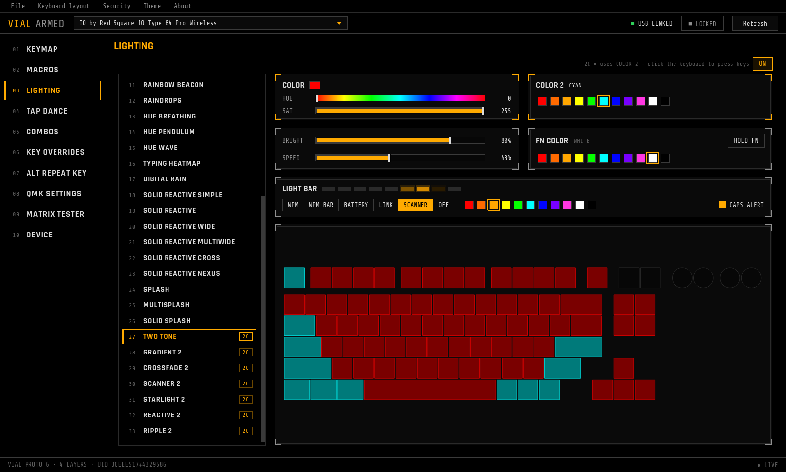
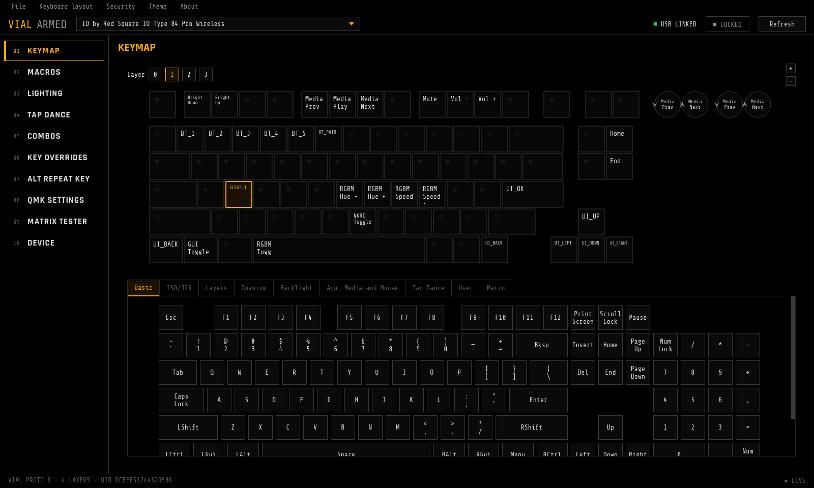
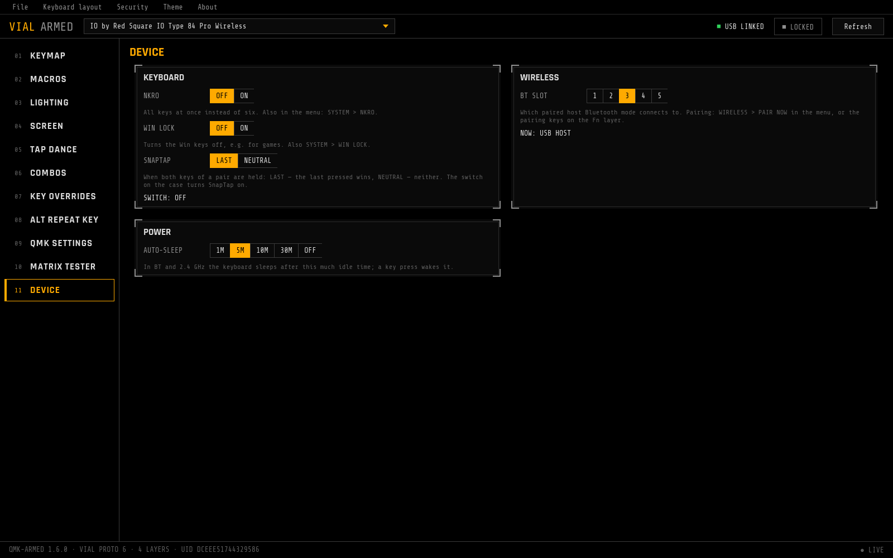
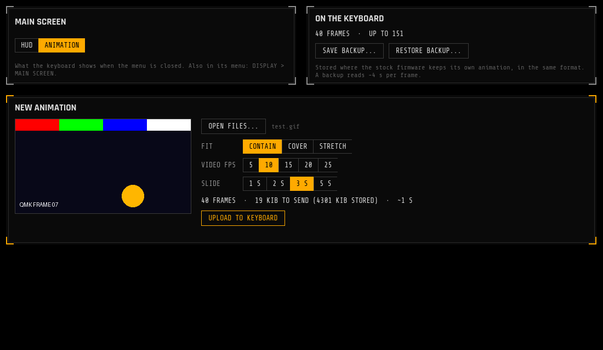

# Vial Armed

A fork of [vial-gui](https://github.com/vial-kb/vial-gui) for keyboards running
**[qmk-armed](https://github.com/backflipinc/qmk-armed)**: the Hi-Tech / Military Black look of the
IO Type 84 Pro's on-screen UI, plus pages for everything the firmware can do beyond stock Vial — every
RGB Matrix effect with a live preview, two-colour effects, the Fn overlay colour, the light bar, auto-sleep and your
own picture, GIF or video on the keyboard's screen.



> [!IMPORTANT]
> The extra pages need a keyboard flashed with [qmk-armed](https://github.com/backflipinc/qmk-armed). Vial Armed
> recognises the firmware by its protocol and shows only what that keyboard reports: RGB Matrix effects on any
> qmk-armed keyboard with per-key RGB, COLOR 2, FN COLOR, the light bar and auto-sleep where the keyboard has them.
> So far the [IO Type 84 Pro Wireless](https://github.com/backflipinc/qmk-armed/tree/armed/keyboards/io/type84_pro)
> is the one keyboard that has them all. With any other Vial keyboard it works like regular Vial in the Armed theme.

## Features

| | |
|---|---|
| 🖤 **Armed theme** | Black panels, amber accent, Rajdhani and Share Tech Mono, square keycaps, numbered side menu — the design code of the keyboard's screen. The stock Vial themes are still under **Theme** |
| 🌈 **Lighting** | Every effect the firmware has, including custom ones — on the IO Type 84 Pro, 7 **two-colour** effects (TWO TONE, GRADIENT 2, CROSSFADE 2, SCANNER 2, STARLIGHT 2, REACTIVE 2, RIPPLE 2); COLOR and COLOR 2, brightness, speed |
| 👁️ **Live preview** | The selected effect runs on the keyboard layout with the firmware's own maths, LED positions and flags. Reactive effects press keys by themselves; click a key to press it |
| 🔦 **Fn overlay** | Pick the FN COLOR and hold **HOLD FN** to see which keys light up while Fn is held |
| 📏 **Light bar** | Mode (WPM, WPM bar, battery, link, scanner, off), colour and Caps Lock alert, with a 9-LED preview |
| 💤 **Device** | Auto-sleep timer, with the options the keyboard offers |
| 🎞️ **Screen** | Put a picture, GIF or video (with ffmpeg installed) on the keyboard's screen: fit, frame rate, slideshow, a preview of exactly what gets uploaded, progress with time left. Switch the main screen between the HUD and the animation; save and restore what's stored, including the stock animation |
| ⌨️ **Everything from Vial** | Keymap and knobs on all layers, macros, tap dance, combos, key overrides, QMK settings, matrix tester |
| 🧭 **Status** | Link and lock state in the top bar, qmk-armed version, Vial protocol, layer count and keyboard UID in the footer |

| Keymap | Device |
|---|---|
|  |  |

| Screen |
|---|
|  |

The original mockups are in [`design/`](design/).

## Install

Download the latest build from [Releases](https://github.com/backflipinc/vial-gui-armed/releases):

| | |
|---|---|
| Linux | `Vial-Armed-x86_64.AppImage` — `chmod +x` and run |
| Windows | `Vial-Armed-setup.exe` (installer) or `Vial-Armed-win.zip` (portable) |
| macOS | `Vial-Armed-mac.dmg` |

On Linux the keyboard needs a udev rule to be reachable without root. For the IO Type 84 Pro, qmk-armed ships one:
[`70-io-type84-pro.rules`](https://github.com/backflipinc/qmk-armed/blob/armed/keyboards/io/type84_pro/udev/70-io-type84-pro.rules);
other keyboards can use [Vial's](https://get.vial.today/manual/linux-udev.html).

On the IO Type 84 Pro, set the mode switch to **USB**: in Bluetooth / 2.4 GHz modes it is off the USB bus and Vial can't see it.

## How it works

Vial talks to the keyboard over Raw HID. VIA and VialRGB only know QMK's built-in effects and one colour,
and VialRGB shows custom effects as *Disable*. qmk-armed adds its own command, **`0xAD`** (unused by VIA and Vial),
that Vial Armed probes on connect:

| Command | |
|---|---|
| `INFO` | `ARMD` magic, protocol and firmware version, **feature flags**, list sizes, maximum brightness |
| `LIST` | effects (QMK id, flags, name), colour presets, light bar modes, sleep options, LEDs (matrix position, x/y, flags) |
| `GET` / `SET` | lighting on/off, effect, hue, saturation, brightness, speed, COLOR 2, FN COLOR, light bar mode / colour / Caps alert, auto-sleep |
| `SAVE` | write hue / saturation / brightness / speed to EEPROM (sliders apply them live without wearing the flash) |
| `SCREEN_*` | screen size and what's stored; upload an animation as a compressed stream (pipelined, ~26 KiB/s over Vial's 32-byte reports); read it back |

The feature flags decide what's shown: RGB Matrix opens the Lighting page and replaces the VialRGB one,
COLOR 2, FN COLOR and LIGHT BAR add their panels, auto-sleep opens the Device page, a screen opens the Screen page. Effect names, colours
and the LED layout come from the keyboard too, so the GUI hardcodes nothing about a particular board.
Without qmk-armed, Vial Armed falls back to the stock Vial lighting page.

Protocol spec and how to add features to a keyboard: [qmk-armed/docs/armed.md](https://github.com/backflipinc/qmk-armed/blob/armed/docs/armed.md).
Implementation here: [`protocol/qmk_armed.py`](src/main/python/protocol/qmk_armed.py), the animation encoder in
[`screen_media.py`](src/main/python/screen_media.py).

## Development

Python 3.6 is what the release builds use (`fbs`); newer Python with PyQt5 5.15 works for development.

```sh
python3 -m venv venv
source venv/bin/activate
pip install -r requirements.txt
fbs run
```

Linux AppImage, the same way CI builds it (needs Docker):

```sh
./util/linux-builder/build-in-docker.sh   # -> util/linux-builder/output/Vial-x86_64.AppImage
```

Releases are built by GitHub Actions: pushing a `v*` tag builds Linux, Windows and macOS and attaches them to a release.

## Roadmap

- More of the on-screen menu: display accent and timeout, battery and link status
- Rename the app and the installers (they are still called Vial inside)

## Credits

- [Vial](https://get.vial.today) / [vial-gui](https://github.com/vial-kb/vial-gui) — the application this is built on
- Fonts: [Rajdhani](https://fonts.google.com/specimen/Rajdhani) and
  [Share Tech Mono](https://fonts.google.com/specimen/Share+Tech+Mono) (SIL Open Font License, see `src/main/resources/base/fonts/`)

Not affiliated with IO by Red Square or the Vial project.

## License

GPL-2.0-or-later, like Vial — see [COPYING](COPYING).
