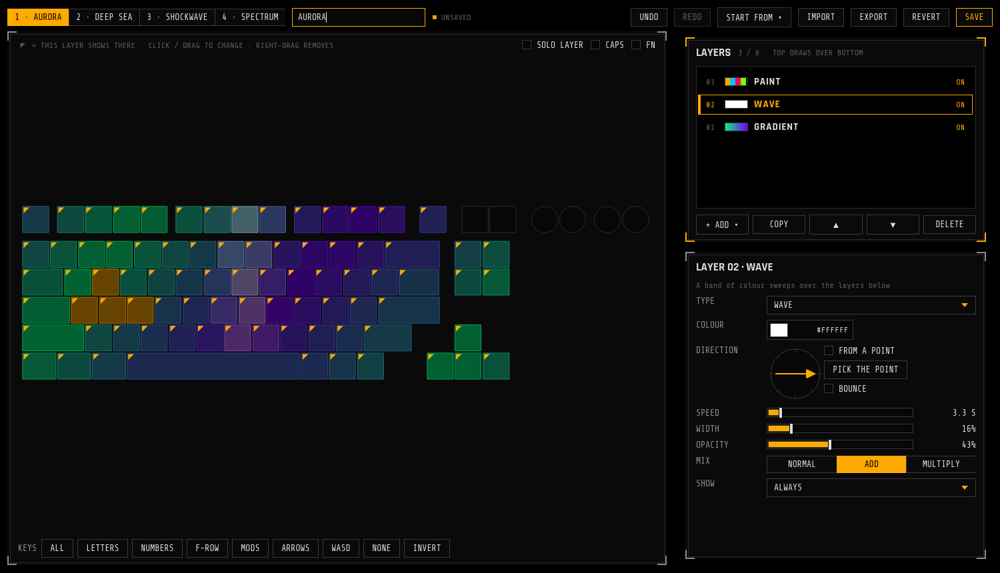
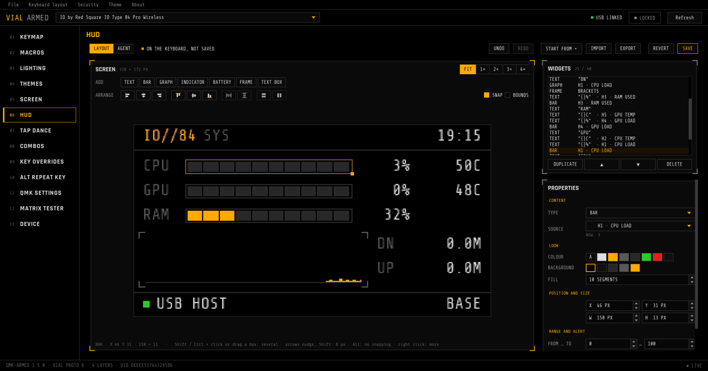
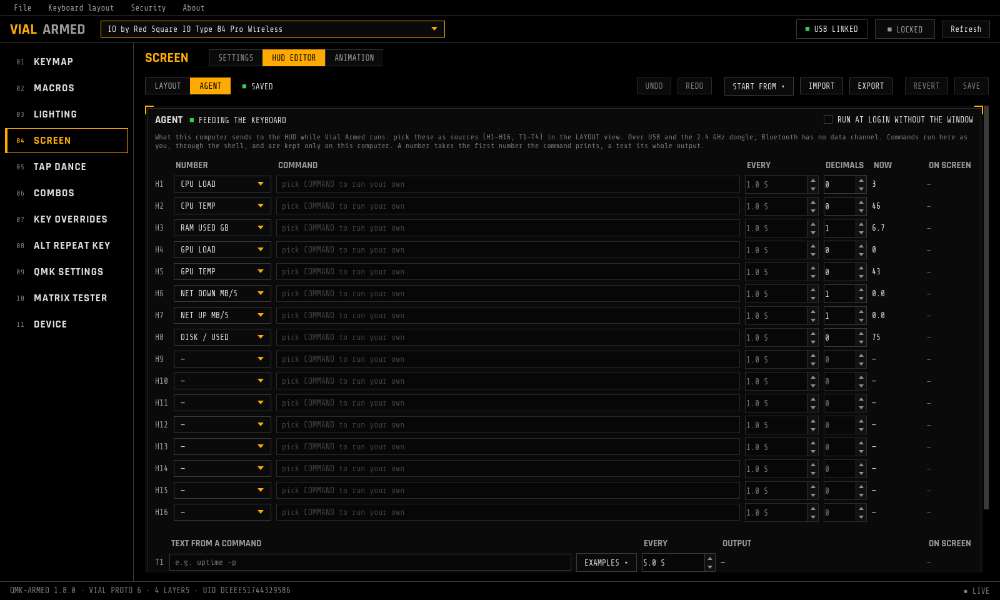

# Vial Armed

A fork of [vial-gui](https://github.com/vial-kb/vial-gui) for keyboards running
**[qmk-armed](https://github.com/backflipinc/qmk-armed)**: the Hi-Tech / Military Black look of the
IO Type 84 Pro's on-screen UI, plus pages for everything the firmware can do beyond stock Vial — every
RGB Matrix effect with a live preview, two-colour effects, the Fn overlay colour, the light bar, auto-sleep, your
own picture, GIF or video on the keyboard's screen, and a HUD you lay out yourself and feed with your computer's
metrics.


> [!IMPORTANT]
> The extra pages need a keyboard flashed with [qmk-armed](https://github.com/backflipinc/qmk-armed). Vial Armed
> recognises the firmware by its protocol and shows only what that keyboard reports: RGB Matrix effects on any
> qmk-armed keyboard with per-key RGB, COLOR 2, FN COLOR, the light bar and auto-sleep where the keyboard has them.
> So far the [IO Type 84 Pro Wireless](https://github.com/backflipinc/qmk-armed/tree/armed/keyboards/io/type84_pro)
> is the one keyboard that has them all. With any other Vial keyboard it works like regular Vial in the Armed theme.

## Features

| | |
|---|---|
| 🖤 **Armed theme** | Black panels, amber accent, Rajdhani and Share Tech Mono, square keycaps, numbered side menu — the design code of the keyboard's screen. The stock Vial themes are still under **Theme** |
| 🌈 **Lighting** | Every effect the firmware has, including custom ones — on the IO Type 84 Pro, 7 **two-colour** effects (TWO TONE, GRADIENT 2, CROSSFADE 2, SCANNER 2, STARLIGHT 2, REACTIVE 2, RIPPLE 2); COLOR and COLOR 2, brightness, speed |
| 🎨 **Theme editor** | **Lighting > THEME EDITOR**: build your own lighting from up to 8 layers — solid, gradient, rainbow, pulse, wave, sparkle, reactive, ripple and per-key paint. Click or drag over keys to choose where a layer shows, or pick a group (letters, F-row, mods, arrows, WASD, the keys bound on Fn). Set the direction on a dial or spread from a key, blend layers, show one only with Caps Lock or Fn. Every change is live on the keyboard; undo / redo, presets, import / export as JSON |
| 👁️ **Live preview** | The selected effect runs on the keyboard layout with the firmware's own maths, LED positions and flags. Reactive effects press keys by themselves; click a key to press it |
| 🔦 **Fn overlay** | Pick the FN COLOR and hold **HOLD FN** to see which keys light up while Fn is held |
| 📏 **Light bar** | Mode (WPM, WPM bar, battery, link, scanner, off), colour and Caps Lock alert, with a 9-LED preview |
| ⚙️ **Device** | NKRO, Win lock, SnapTap mode, Bluetooth slot, auto-sleep — what the keyboard's own menu sets, shown for what the keyboard has |
| 🎞️ **Screen** | **Screen > SETTINGS**: the screen's accent colour and off timeout; put a picture, GIF or video (with ffmpeg installed) on the keyboard's screen: fit, frame rate, slideshow, a preview of exactly what gets uploaded, progress with time left. Switch the main screen between the HUD and the animation; save and restore what's stored, including the stock animation. Sets the keyboard's clock from this computer when it connects, 24H / 12H / off |
| 📟 **HUD editor** | **Screen > HUD EDITOR**: lay out the keyboard's main screen from widgets — text with values, bars, graphs, indicators, the battery icon, frames and lines, multi-line text — on a preview drawn pixel for pixel like the keyboard draws it, with its own fonts and colour roles, so the result keeps the look of the firmware. Drag with smart guides, resize, nudge with arrows; select several and align, distribute or match their sizes; reorder in the widget list; copy / paste, undo / redo, presets (keyboard default, system monitor, console, big clock), import / export as JSON. Live on the keyboard as you edit, SAVE keeps it |
| 📡 **HUD agent** | Feeds the HUD with this computer's CPU / GPU load and temperature, RAM, VRAM, swap, network, disk, load average and laptop battery, plus the first number or the whole output of any command or script (Cyrillic is spelled in Latin letters). Runs inside Vial Armed, or without a window: `vial-armed --agent`, with a RUN AT LOGIN switch on Linux. Over USB and the 2.4 GHz dongle |
| ⌨️ **Everything from Vial** | Keymap and knobs on all layers, macros, tap dance, combos, key overrides, QMK settings, matrix tester |
| 🧭 **Status** | Link and lock state in the top bar, qmk-armed version, Vial protocol, layer count and keyboard UID in the footer |

| Keymap | Device |
|---|---|
|  |  |

| Themes | Screen |
|---|---|
|  |  |

| HUD: layout | HUD: agent |
|---|---|
|  |  |

The original mockups are in [`design/`](design/); what the keyboard's own screen looks like, HUD layouts included, is in
[qmk-armed's mockup](https://github.com/backflipinc/qmk-armed/blob/armed/keyboards/io/type84_pro/docs/images/ui-mockup.png).

## Install

Download the latest build from [Releases](https://github.com/backflipinc/vial-gui-armed/releases):

| | |
|---|---|
| Linux | `vial-armed-<version>-x86_64.AppImage` — `chmod +x` and run; or `vial-armed_<version>_amd64.deb` (Debian / Ubuntu, installs to `/opt/vial-armed`) |
| Windows | `vial-armed-<version>-setup.exe` (installer) or `vial-armed-<version>-win.zip` (portable) |
| macOS | `vial-armed-<version>-mac.dmg` |

The version is the release tag (`v1.5.0` → `1.5.0`); builds of untagged commits are named after the last tag and the
commit (`1.5.0+3.gabc1234`), and **About vial-armed** shows the same.

On Linux the keyboard needs a udev rule to be reachable without root. For the IO Type 84 Pro, qmk-armed ships one:
[`70-io-type84-pro.rules`](https://github.com/backflipinc/qmk-armed/blob/armed/keyboards/io/type84_pro/udev/70-io-type84-pro.rules);
other keyboards can use [Vial's](https://get.vial.today/manual/linux-udev.html).

The IO Type 84 Pro (firmware 1.5+) is found by USB or through its **2.4 GHz dongle** (listed as `… [2.4G]`; mode switch
on 2.4 GHz). Over the dongle each request takes ~20 ms, so connecting takes a few seconds, and screen animations are
transferred over USB only. Bluetooth has no channel for it.

## How it works

Vial talks to the keyboard over Raw HID. VIA and VialRGB only know QMK's built-in effects and one colour,
and VialRGB shows custom effects as *Disable*. qmk-armed adds its own command, **`0xAD`** (unused by VIA and Vial),
that Vial Armed probes on connect:

| Command | |
|---|---|
| `INFO` | `ARMD` magic, protocol and firmware version, **feature flags**, list sizes, maximum brightness |
| `LIST` | effects (QMK id, flags, name), colour presets, light bar modes, sleep options, LEDs (matrix position, x/y, flags) |
| `GET` / `SET` | lighting on/off, effect, hue, saturation, brightness, speed, COLOR 2, FN COLOR, light bar mode / colour / Caps alert, auto-sleep, main screen, clock format, NKRO, Win lock, SnapTap mode, screen accent and timeout, Bluetooth slot |
| `SAVE` | write hue / saturation / brightness / speed to EEPROM (sliders apply them live without wearing the flash) |
| `SCREEN_*` | screen size and what's stored; upload an animation as a compressed stream (pipelined, ~26 KiB/s over Vial's 32-byte reports); read it back |
| `THEME_*` | theme slots and their layout; read, write live, save, revert |
| `CLOCK_*` | read and set the keyboard's local time, whole seconds |
| `HUD_*` | the HUD's sources, colour roles and fonts (for the preview); read, write live, store or revert the layout; push numbers and text from the host (no reply, so the agent never gets in the way) |

The feature flags decide what's shown: RGB Matrix opens the Lighting page and replaces the VialRGB one,
COLOR 2, FN COLOR and LIGHT BAR add their panels, auto-sleep, NKRO, SnapTap and the like fill the Device page, theme slots add THEME EDITOR to Lighting, a screen opens the Screen page with SETTINGS and HUD EDITOR. Effect names, colours
and the LED layout come from the keyboard too, so the GUI hardcodes nothing about a particular board.
Without qmk-armed, Vial Armed falls back to the stock Vial lighting page.

Protocol spec and how to add features to a keyboard: [qmk-armed/docs/armed.md](https://github.com/backflipinc/qmk-armed/blob/armed/docs/armed.md).
Implementation here: [`protocol/qmk_armed.py`](src/main/python/protocol/qmk_armed.py), the animation encoder in
[`screen_media.py`](src/main/python/screen_media.py), themes in [`lighting_theme.py`](src/main/python/lighting_theme.py)
and the firmware's theme renderer ported to Python in [`theme_render.py`](src/main/python/theme_render.py);
the HUD in [`hud_layout.py`](src/main/python/hud_layout.py), its renderer (Quantum Painter's fonts and colour maths)
in [`hud_render.py`](src/main/python/hud_render.py) and the agent in [`hud_agent.py`](src/main/python/hud_agent.py).

### HUD agent

While Vial Armed runs, it sends what the HUD editor's AGENT view lists: up to 16 numbers (H1–H16) and 4 texts (T1–T4).
Pick them as sources (H1–H16, T1–T4) in the LAYOUT view. Each number is a metric or a command whose first printed number is taken;
each text is a command whose output is shown (the end of it when it's longer than 159 characters). The settings
live in `~/.config/vial-armed/hud-agent.json` (`%APPDATA%\vial-armed` on Windows); commands are never stored on the
keyboard. To keep the HUD fed without the window, run `vial-armed --agent` (or tick RUN AT LOGIN): it finds the
keyboard by itself, sets its clock, follows changes to the settings, and steps aside while Vial Armed is open.

## Development

Python 3.6 is what the release builds use (`fbs`); newer Python with PyQt5 5.15 works for development.

```sh
python3 -m venv venv
source venv/bin/activate
pip install -r requirements.txt
fbs run
```

Linux AppImage, the same way CI builds it (needs Docker):

```sh
python3 util/set_version.py              # optional: version from git, as CI does
./util/linux-builder/build-in-docker.sh   # -> util/linux-builder/output/vial-armed-x86_64.AppImage, vial-armed_amd64.deb
```

Releases are built by GitHub Actions: pushing a `v*` tag builds Linux, Windows and macOS and attaches them to a release.

## Roadmap

- More of the on-screen menu: display accent and timeout, battery and link status
- Rename the app and the installers (they are still called Vial inside)

## Credits

- [Vial](https://get.vial.today) / [vial-gui](https://github.com/vial-kb/vial-gui) — the application this is built on
- Fonts: [Rajdhani](https://fonts.google.com/specimen/Rajdhani) and
  [Share Tech Mono](https://fonts.google.com/specimen/Share+Tech+Mono) (SIL Open Font License, see `src/main/resources/base/fonts/`)

Not affiliated with IO by Red Square or the Vial project.

## License

GPL-2.0-or-later, like Vial — see [COPYING](COPYING).
